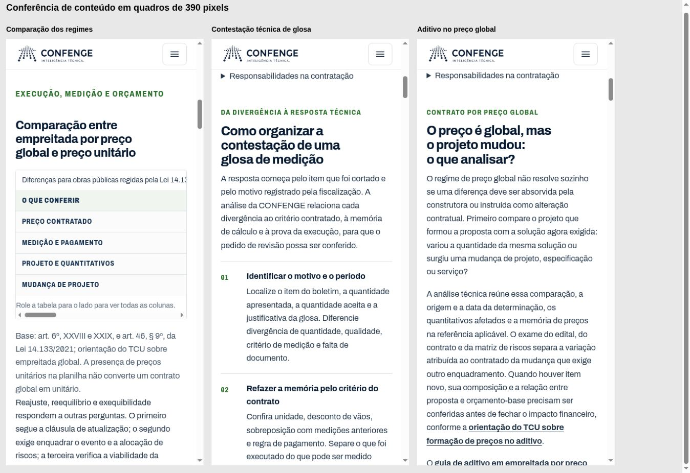

# Tráfego qualificado e conversão da CONFENGE

Data: 29/10/2026. Decisão: EXECUTE_NOW. Frente: INBOUND ENGINE.
Alavancas: distribuição, receita, confiança e automação.
Arquitetura preservada: ADR-STRAT-002, ADR-STRAT-004 e RUNTIME-AUTHORITY.

## O problema e o comportamento entregue

As páginas de projetos descreviam o serviço com títulos abstratos, recebiam poucos links contextuais e encaminhavam o pedido por uma triagem genérica. A jornada `projetos` não era reconhecida pelo formulário compartilhado, que aceita `projeto`.

A home agora nomeia projetos e serviços de engenharia. Onze páginas técnicas apresentam o serviço e suas entregas na abertura. As treze páginas do gerador compartilham contato direto com contexto: projetos seguem a jornada correta; empresa e método mantêm a escolha genérica. O visitante chega ao formulário com uma ação a partir da abertura, ou inicia uma conversa específica no WhatsApp.

A origem inicial permanece preservada mesmo quando a pessoa passa de um artigo para um serviço antes de entrar em contato. Sem armazenamento de sessão, a navegação preserva o contexto na mesma janela pelo mecanismo de continuidade já existente, sem criar endereços parametrizados para os buscadores. Sem JavaScript, os canais diretos continuam disponíveis; o formulário não afirma registrar pedidos sem seu funcionamento normal.

## Evidência de procura

Fonte: Search Console da propriedade conectada `sc-domain:confenge.com.br`, consultada em 29/10/2026 pelo conector Windsor.ai. Período: 29/09 a 26/10/2026, 28 dias. Arquivo: [gsc-baseline.json](gsc-baseline.json).

- Propriedade: 88 cliques, 1.766 impressões, CTR de 4,98%, posição média 5,983.
- Home: 26 cliques.
- Aditivo em empreitada por preço global: 17 cliques.
- BDI diferenciado e mobilização/desmobilização: 8 cliques cada.
- Medições e glosas: 6 cliques em 236 impressões.
- SINAPI desonerado/não desonerado: 2 cliques em 280 impressões, CTR de 0,71%.

O detalhamento por consulta expôs somente 23 cliques. Na conferência desta rodada, a consulta isolada retornou 119 impressões em 29 linhas; as 399 impressões e 61 linhas do registro anterior foram preservadas no histórico do JSON, pois o universo de impressões corresponde à agregação por página. A causa exata da lacuna de cliques permanece desconhecida. Não se pode classificar o restante como marca ou sem marca. Impressões por página e totais da propriedade têm agregações diferentes.

O volume ainda é pequeno. Os dados orientam prioridade; não demonstram aumento de tráfego ou conversão após esta alteração. Não foi obtida uma linha de base de pedidos comerciais, propostas ou receita nesta sessão.

## Intervenções e hipótese de ganho

| Intervenção | Trabalho do visitante | Hipótese verificável |
| --- | --- | --- |
| Home e aberturas mais concretas | Reconhecer serviço, entrega e próximo passo | Mais visitas pertinentes às páginas de serviço |
| Links da home, projetos, terceirização e três artigos | Chegar diretamente à disciplina necessária | Melhor descoberta de quatro serviços já existentes |
| Título de SINAPI alinhado à pergunta respondida | Escolher o resultado que responde qual referência usar | CTR da página melhora em faixas de posição comparáveis |
| Proposta direta e WhatsApp contextual | Pedir proposta sem repetir a necessidade | Mais contatos reais por visita de serviço |
| Jornada e primeira origem corretas | Manter assunto e origem até o pedido | Menos pedidos classificados como outra necessidade e atribuição íntegra |
| Hierarquia e alvos de toque no celular | Ler e acionar o contato em tela estreita | Contatos acessíveis sem corte horizontal |

A expansão usa páginas existentes. A revisão inicial encontrou 126 páginas indexáveis, todas presentes nos sitemaps, sem recurso interno ou fragmento ausente. Os quatro artigos B2G com mais procura já tinham encaminhamento comercial adequado; seus corpos foram preservados.

Projetos e serviços documentais permanecem disponíveis nacionalmente. A abertura explicita vistorias presenciais na Grande Florianópolis, em coerência com o JSON-LD da oferta de inspeção.

## Revisão adversarial

Revisores independentes encontraram e a implementação corrigiu:

1. Jornada plural rejeitada pelo formulário.
2. Nova passagem pelo serviço sobrescrevendo a primeira origem do artigo.
3. Páginas institucionais pré-selecionando projeto para outras necessidades.
4. Cobertura nacional de inspeção no JSON-LD incompatível com a atuação presencial.
5. Título e espaçamento excessivos reduzindo a visibilidade do contato no celular.
6. Novos links exigindo atualização explícita do inventário de ações e do hash do contrato consumidor.
7. Continuidade sem armazenamento preenchendo a jornada oculta, mas deixando o seletor visível vazio.
8. Endereços parametrizados de contato incompatíveis com o contrato de SEO, substituídos por destino canônico e atributos de contexto.
9. Caminhos gerais de estruturas e instalações retirados do conteúdo do hub ao priorizar disciplinas específicas. Ambos foram restituídos no conteúdo, preservando os atalhos novos, com regressão e navegação conferidas.

Os quatro destinos disciplinares já eram reconhecidos no navegador e no servidor. A verificação do classificador confirmou `content_to_service` nos artigos. Cliques no WhatsApp continuam sendo intenção de contato, sem recibo comercial fictício.

## Validação

A geração completa `npm run build:site` passou, junto dos controles de entrada, SEO, navegação, privacidade, jornada, formulário e persistência. Os 124 testes focados e 74 subtestes passaram. O resultado por verificação está em [validation.json](validation.json). Os testes de regressão usam o endereço efetivamente gerado e cobrem chegada desde artigo/Google, contexto do serviço e uso com armazenamento indisponível.

A conferência no navegador usa o artefato público gerado, sem submeter pedidos em produção. A versão estreita é examinada em iframes com larguras de 390 e 320 pixels; a barra de rolagem ocupa parte da área útil. Isso confere o comportamento responsivo real do navegador, sem afirmar teste em aparelho físico. Evidências visuais e resultado final são registrados nesta pasta.

Após o CI identificar a evidência anterior vinculada à antiga home e ao antigo script, as 25 rotas do censo foram recapturadas em 50 viewports de 1366×768 e 390×844. A medição usou o Cloud Browser via CUA, o mesmo algoritmo de leitura de caixas do medidor e as mesmas funções puras de veredito. A fonte veio de um checkout Git esparso e limpo no commit fda436f4, com identidade de cada página, H1 e dependências conferida antes e depois. O método consta em measurement_transport no arquivo de evidências. O gate original aprovou 1.942 de 1.942 verificações. Não se atribui compreensão humana a essa medição.

Ambiente local: Node 24.22.1; o CI do repositório usa Node 22. A execução local não substitui os controles do CI nem a aceitação do runtime publicado.

## Medição após publicação

Um experimento estrutural: distribuir a procura existente até o serviço específico e preservar seu contexto até o pedido recebido.

Comparar os 28 dias completos anteriores e posteriores à publicação; revisar novamente com 56 dias se os eventos continuarem escassos. Usar os relatórios já existentes, sem criar outro painel ou agendamento:

1. Search Console por página e separadamente por consulta: cliques, impressões, CTR e faixas de posição; separar marca quando os dados permitirem.
2. Eventos do site: artigo para serviço, visita de serviço, intenção de contato, início e envio de formulário.
3. Recibos reais: pedidos persistidos por origem e serviço, excluindo testes, duplicatas e sinais sintéticos.
4. Warmbly: oportunidade qualificada, proposta, contrato, faturamento e recebimento como estágios distintos.

Pedidos persistidos e oportunidades qualificadas têm precedência sobre contagem de cliques. O contato por WhatsApp só deve avançar no funil quando houver evidência do atendimento. A revisão conjunta de textos e jornada não permite atribuir causalmente cada resultado a uma mudança isolada.

## Publicação e reversão

A produção continua sendo `confenge.com.br`, no fluxo protegido GitHub/Netcup. A primeira etapa foi publicada pelo PR [#758](https://github.com/tjsasakifln/web-cfg/pull/758), merge `38271d674f186682539a699d5636ddb9bf76597c`, com [release aceito](https://github.com/tjsasakifln/web-cfg/actions/runs/40890976677). A identidade foi novamente conferida no domínio oficial no início desta rodada.

A reversão é o revert do commit da alteração. Rotas, índices e acervo público são preservados. A eventual promoção segue a verificação e reversão já existentes no repositório, sem mudança de DNS ou infraestrutura.

## Segunda etapa: procura contratual e comparação dos regimes

Decisão em 29/10/2026: EXECUTE_NOW. Frente INBOUND ENGINE, alavancas distribuição, receita e confiança. Tempo para evidência técnica: nesta entrega; para procura: 28 e 56 dias completos. O trabalho do visitante é distinguir um risco de proposta, uma medição contestada ou uma alteração de projeto e encontrar o apoio técnico correspondente. O experimento estrutural continua único: atrair procura comercial pertinente para serviços claros e preservar o contexto até o pedido real. Cem visitas usam a mesma biblioteca, os mesmos serviços e a captura existente, sem cem páginas ou operações manuais.

A consulta conectada atualizada reproduziu os três períodos completos e a tendência anterior. Dados e cálculos saneados estão em [gsc-growth-analysis.json](gsc-growth-analysis.json). São evidências históricas de pesquisa; não substituem a autoridade durável do GSC no runtime.

| Período de 28 dias em 2026 | Cliques | Impressões | CTR |
| --- | ---: | ---: | ---: |
| 04/08 a 31/08 | 28 | 1.176 | 2,38% |
| 01/09 a 28/09 | 72 | 1.140 | 6,32% |
| 29/09 a 26/10 | 88 | 1.766 | 4,98% |

Todos os dias retornados foram calculados por código. O pedido de extensão a 12/05 retornou dados somente desde 14/07. Os 21 dias anteriores a 04/08 não formam outro período equivalente. O dia 27/10 foi separado para comparabilidade; 28/10 não retornou linha e não foi tratado como zero. A fonte foi consultada com `include_fresh_data=false`.

### Uma carteira e um plano

| Ordem e decisão | Evidência | Público, serviço e obstáculo | Alteração ou motivo de espera | Esforço, confiança e risco |
| --- | --- | --- | --- | --- |
| 1 EXECUTE_NOW: medições e glosas | 9 cliques/528 impressões em 84 dias; 6/236 no último período, posição 4,27 | Construtora com corte ou divergência; análise e contestação técnica; poucos cliques na exposição conquistada | Snippet específico, roteiro por item, parcela incontroversa e distinção entre glosa, ateste, pagamento e alteração | Moderado; procura observada, efeito incerto; preservar URL, formulário e exemplo |
| 2 EXECUTE_NOW: global versus unitário | 1/254 em 84 dias; 0/85 e posição 9,42 no último período | Quem prepara proposta ou executa contrato; diagnóstico, medições ou aditivos; abertura não respondia primeiro à comparação literal | Título e resposta direta, quadro de diferenças, fontes e caminhos segundo a fase do contrato | Moderado; confiança média; pode atrair público informativo, sem pressupor compra |
| 3 EXECUTE_NOW: serviço de aditivos | 1/132 em 84 dias; 67 para 1 impressão nos últimos períodos; artigo global já tem 22/189 | Construtora com projeto alterado; memória de escopo, quantidade e preço; serviço com pouca exposição recente | Apresentação concreta do trabalho e seção de preço global ligada ao artigo existente; investigar indexabilidade antes de atribuir causa | Pequeno a moderado; confiança média; não inferir canibalização nem reescrever o artigo forte |
| 4 DEFER: limites de aditivo | 1/76 no último período | Empresa enquadrando alteração | Preservar resposta; próxima investigação se a procura justificar | Moderado; tema legal requer fonte atual |
| 5 DEFER: BDI e mobilização | Ambos 8/138 no último período | Equipe de orçamento; auditoria de planilha | Proteger respostas que já atraem visitas; sem achado que justifique reescrita | Baixo ganho marginal identificado, risco de perder resposta útil |
| 6 DEFER: SINAPI | 7/819 em 84 dias | Orçamentistas e possíveis compradores de revisão | Título já melhorado no PR #758; intenção comercial não demonstrada para justificar liderar esta rodada | Baixa confiança sobre compra; não priorizar apenas impressões |
| 7 VALIDATE: expansão para outras verticais | Serviços de projetos melhorados no PR #758; pesquisa externa mostra linguagem de contratação, sem volume validado | Projetos, SST, perícias e revisão de orçamento | Investigar lacuna distinta antes de criar rota; ausência de cliques não prova ausência de mercado | Esforço maior; procura própria e retorno ainda incertos |

Não há ticket, margem ou taxa comercial validados para pontuação financeira. A ordem compara proximidade de um problema contratual, procura conquistada, esforço total e risco. A pesquisa comercial e o manual interno autorizado confirmaram aderência de medições, aditivos e orçamentação; nenhum dado individual ou documento interno foi incorporado ao repositório. Não foi necessária investigação extensa de CRM para desempatar estas alterações de conteúdo.

O conjunto ficou fixado nas três rotas acima. As únicas dependências adicionais são fonte canônica, datas, inventário de links, recaptura de integridade e controles já existentes. Não há nova página, preço, infraestrutura, crawler, CRM, painel ou agendamento. O corpo do artigo global/unitário também é mantido no gerador histórico reaplicável `scripts/organic/apply_orcamento_cluster_rewrite.py`; sua regressão continua exigindo paridade com o HTML.

### Limitações que mudam a interpretação

Em 84 dias, a propriedade retorna 188 cliques/4.082 impressões; página retorna 188/5.230. Consulta isolada retorna 45/236 em 53 linhas; data+consulta retorna os mesmos 45/236 em 135 linhas. Página+consulta e página+dispositivo retornam somente 45/708, embora a dimensão de dispositivo isolada reconcilie com a propriedade. Esses cruzamentos incompletos não foram usados para diagnosticar defeito móvel. A interface descoberta não expõe paginação, limite de linhas ou deslocamento; os resultados indicaram conclusão, mas a extração upstream não pôde ser certificada. A causa dos 143 cliques sem consulta disponível permanece desconhecida.

Desktop e celular têm composições e posições diferentes. Brasil concentra 187 dos 188 cliques, sem base para orientar expansão internacional. A pesquisa externa fornece sinais qualitativos de vocabulário e necessidade, sem alegar volume mensal, dificuldade numérica ou chance de posição.

### Ganho condicionado, sem previsão de contratos

Para medições, a base é o último período de 28 dias: 236 impressões e 6 cliques. A página já vinha crescendo (1/110, 2/182 e 6/236), portanto não se atribui essa tendência à entrega atual.

| Hipótese explícita para outros 28 dias | Cliques calculados | Adicionais sobre 6 |
| --- | ---: | ---: |
| Exposição e CTR mantidos | 6 | 0 |
| 236 impressões e CTR de 4% | 9,44 | 3,44 |
| 236 impressões e CTR de 6% | 14,16 | 8,16 |
| Exposição 25% maior e CTR de 4% | 11,80 | 5,80 |

São cenários aritméticos condicionados, sem probabilidade ou intervalo estatístico. BDI e mobilização têm CTR próximo de 6%, mas intenção e posição diferem, com amostra pequena; não são controles equivalentes. Não somar cenário de página e de consultas da mesma página. Não há estimativa pontual defensável para recuperação de aditivos ou crescimento da comparação de regimes. Sem taxas verificadas, não há previsão de oportunidades ou receita. O resultado comercial só avança com evidência de conversa, pedido, oportunidade, proposta, contrato, faturamento e recebimento, cada qual em sua fonte responsável.

### Fontes e revisão

Fontes primárias conferidas nesta rodada: [Lei 14.133/2021](https://www.planalto.gov.br/ccivil_03/_ato2019-2022/2021/lei/L14133.htm), [TCU: empreitada global](https://licitacoesecontratos.tcu.gov.br/4-4-1-2-empreitada-por-preco-global-epg/), [TCU: empreitada unitária](https://licitacoesecontratos.tcu.gov.br/4-4-1-1-empreitada-por-preco-unitario-epu/) e [TCU: pagamento](https://licitacoesecontratos.tcu.gov.br/6-1-7-pagamento/). A definição legal de preço unitário usa o inciso XXVIII do art. 6º; a planilha em preço global é tratada no art. 56, § 5º. Não se transplantou um numeral divergente do rodapé do manual.

Revisores independentes questionaram interpretação do GSC, valor comercial, propriedade de intenção, precisão técnica e implementação. A revisão preservou o artigo forte de aditivo e BDI, rejeitou nova landing de glosa, identificou o gerador reaplicável e corrigiu simplificações que tratavam qualquer variação no global como margem automaticamente absorvida. A manutenção técnica inclui a cadeia de hashes, o pin da rota comercial, o canário e a primeira dobra, sempre com bytes e commit reais, sem dispensa de controles.

A avaliação usa o painel diário e os relatórios existentes. Se esta etapa for publicada em 29/10, as janelas completas são 30/10 a 26/11 (28 dias) e 30/10 a 24/12 (56 dias); a linha de base comparável termina no último dia completo disponível antes da publicação. Confrontar a tendência prévia, composição e intervenções simultâneas, incluindo o PR #758. Nenhuma atribuição causal isolada é inferida de antes/depois.

As validações, a revisão final e a identidade efetivamente publicada serão registradas em `growth-validation.json` e no PR desta etapa. Enquanto esses registros não confirmarem o release terminal, esta seção documenta a implementação candidata.

A investigação de aditivos não encontrou impedimento técnico atual: HTTP 200, canonical próprio, indexação permitida, sitemap e redirecionamentos corretos. As 43 revisões HTML examinadas desde agosto preservaram canonical e robots. Isso não comprova inclusão no índice Google nem explica a redução de impressões. A causa permanece desconhecida.

Validação integrada da segunda etapa: build completo; 289 testes orgânicos, 123 de proteção B2G, 34 de propriedade de intenção e 41 de taxonomia; SEO sem erros ou avisos, com 126 rotas indexáveis; atribuição, privacidade, formulário, navegação, HTML e acessibilidade estática aprovados. A conferência de fonte mediu 25 rotas em 50 quadros e passou 1.942/1.942 verificações, com todos os 56 insumos confrontados com os bytes do commit de conteúdo. O censo mantém 41 formulários; os dois links novos para captura elevam as ações declaradas a 278, com zero problemas.

O navegador conferiu desktop e quadros de 390/320 pixels (área útil de 375/305 por causa da barra de rolagem), sem transbordamento do documento nas três páginas. A tabela possui sua própria rolagem horizontal e foco por teclado. O percurso do artigo ao formulário de medições exibiu o assunto correto no campo de contexto. A primeira origem e o comportamento sem armazenamento foram cobertos pelas regressões do listener real. Nenhum pedido de produção ou mensagem a cliente foi enviado.

